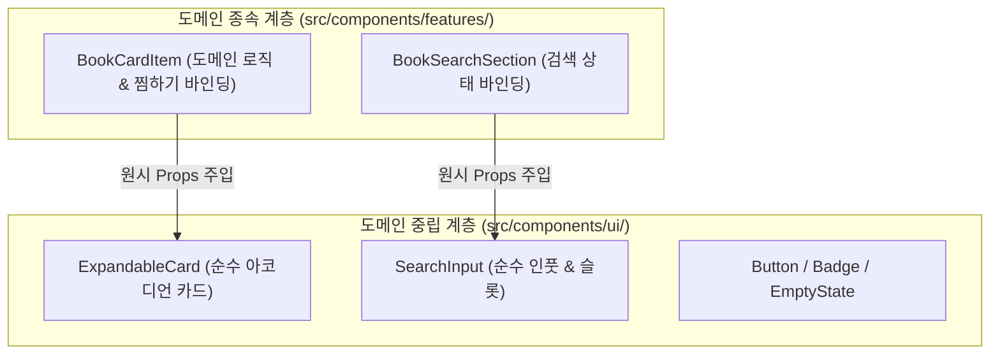

# ADR-0007: 도메인 중립 뷰 컴포넌트 계층 분리 및 훅 응답 캡슐화 설계

- **상태 (Status)**: 승인 (Accepted)
- **일자 (Date)**: 2026-10-22
- **결정자 (Deciders)**: 변주영

---

## 1. 배경 및 맥락 (Context)
컴포넌트가 도메인 모델(`Book` 등)에 직접 의존하면, 디자인 시스템 레벨의 컴포넌트 재사용성이 크게 떨어지고 다른 도메인이나 화면에서 재활용하기 어려워집니다. 또한 커스텀 훅이 TanStack Query의 방대한 내부 객체(`data`, `fetchNextPage`, `refetch`, `isFetching` 등)를 그대로 UI 컴포넌트로 전달하면 컴포넌트가 훅의 내부 구현 세부사항에 과도하게 결합(Tight Coupling)되는 문제가 발생합니다.

---

## 2. 결정 내용 (Decision)

### 1) UI 컴포넌트 계층 분리 (Presentational vs Container)
컴포넌트를 **도메인 중립적 UI(Presentational)**와 **도메인 종속적 UI(Container/Feature)**의 2개 계층으로 철저히 분리합니다.



1. **도메인 중립 컴포넌트 (`src/components/ui/`)**:
   - 도메인 인터페이스(`Book` 등)에 **일절 의존하지 않습니다**.
   - 순수 원시값/독립 인터페이스 props(`title`, `subTitle`, `imageUrl`, `price`, `isExpanded`, `onToggle`, `actions` 등)만 받아 오직 스타일과 뷰 표현만 담당합니다.
   - 예: `ExpandableCard`, `SearchInput`, `Button`, `EmptyState`, `Badge`, `Dropdown` 등.
2. **도메인 종속 컴포넌트 (`src/components/features/`)**:
   - `Book` 도메인 모델과 비즈니스 로직(찜하기 토글, 상세 펼침 상태, 링크 이동)을 주입받아, 순수 `ui/` 컴포넌트에 props를 매핑하여 조립(Composition)합니다.
   - 예: `BookCardItem`, `BookSearchContainer`, `FavoriteBookContainer` 등.

---

### 2) 커스텀 훅의 응답 캡슐화 (Minimal & Expressive Hook Returns)
커스텀 훅은 서드파티 라이브러리의 원시 상태를 그대로 누출하지 않고, **UI 컴포넌트가 렌더링에 꼭 필요한 인터페이스만 정제하여 반환**합니다.

```typescript
// ❌ 지양: React Query의 거대한 원본 객체를 그대로 노출
const { data, fetchNextPage, hasNextPage, isFetchingNextPage, status, error } = useInfiniteQuery(...);

// ✅ 지향: UI가 소비하기에 가장 직관적이고 꼭 필요한 데이터만 캡슐화하여 반환
export interface UseBookSearchResult {
  books: Book[];                 // pages가 평탄화(flatten)된 도서 목록
  totalCount: number;            // 전체 검색 결과 건수
  isLoading: boolean;            // 최초 검색 로딩 중
  isFetchingNextPage: boolean;   // 스크롤 추가 로딩 중
  hasNextPage: boolean;          // 추가 로딩 가능 여부
  loadMore: () => void;          // fetchNextPage 대신 직관적인 명명
  isEmpty: boolean;              // 검색 결과가 0건인지 여부
  isError: boolean;              // 에러 발생 여부
}
```

---

## 3. 결정의 결과 및 영향 (Consequences)
- **높은 재사용성**: `ui/` 디렉터리의 컴포넌트들은 디자인 시스템 카탈로그(Storybook 등)에 등록 가능한 순수 UI 자산으로 격리됩니다.
- **테스트 용이성**: 뷰 컴포넌트는 단순 props 전달만으로 시각적 회귀 및 스냅샷 테스트가 가능하며, 비즈니스 로직과 분리되어 테스트 복잡도가 극적으로 낮아집니다.
- **클린 컴포넌트**: 컴포넌트 파일이 짧고 직관적이며, 훅과 컴포넌트 간의 책임(SRP)이 명확해집니다.
