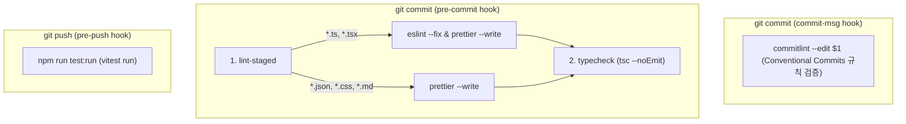

# ADR-0008: 코드 품질 및 커밋 규약 보증을 위한 Git Hooks & CI/CD 파이프라인 스펙

- **상태 (Status)**: 승인 (Accepted)
- **일자 (Date)**: 2026-10-22
- **결정자 (Deciders)**: 변주영

---

## 1. 배경 및 맥락 (Context)
개발 과정에서 발생할 수 있는 정적 타입 불일치, 린트 룰 위반, 코드 포맷팅 불일치, 테스트 실패뿐만 아니라, **일관성 없고 모호한 커밋 메시지 작성**을 방지해야 합니다. 이를 위해 Git Hooks 생명주기에 **Commitlint(Conventional Commits 규칙 강제)**를 포함하여 히스토리의 가독성과 추적성을 프로덕션 수준으로 보장합니다.

---

## 2. 도구 체인 (Toolchain) 스펙

| 검사 영역 | 도구 (Tool) | 버전 | 역할 |
| :--- | :--- | :---: | :--- |
| **Commit Message Linter** | **Commitlint** (`@commitlint/cli`, `@commitlint/config-conventional`) | `^19.x` | Conventional Commits 규칙(`feat:`, `fix:` 등) 준수 강제 |
| **Git Hooks Manager** | **Husky** | `^9.x` | Git 훅(`commit-msg`, `pre-commit`, `pre-push`) 생명주기 관리 |
| **Staged Linting** | **lint-staged** | `^15.x` | Git Staged 상태의 변경된 파일만 타깃으로 고속 검사 |
| **Type Check** | **TypeScript Compiler (`tsc`)** | `~5.7.x` | `--noEmit` 옵션을 통한 전체 정적 타입 정합성 검사 |
| **Linter** | **ESLint** | `^9.x` | 코드 안티패턴 및 React Hooks 규칙 강제 (`--max-warnings 0`) |
| **Formatter** | **Prettier** | `^3.x` | 일관된 코드 스타일 포맷팅 및 충돌 방지 (`eslint-config-prettier`) |
| **Test Runner** | **Vitest** | `^3.x` | Vite 기반 초고속 단위 및 컴포넌트 테스트 실행 |
| **Test Environment** | **JSDOM + React Testing Library** | 최신 | 브라우저 DOM 환경 모킹 및 사용자 중심 컴포넌트 테스팅 |
| **CI Platform** | **GitHub Actions** | - | PR 및 main 푸시 시 자동 검증 워크플로우 실행 |
| **CD Platform** | **Cloudflare Pages** | - | 엣지 기반 글로벌 정적 호스팅 및 서버리스 프록시 배포 |

---

## 3. Git Hooks 세부 스펙



### 3.1 `commit-msg` Hook 스펙 (⭐️ 신규 추가)
- **목적**: 커밋 메시지가 표준 `Conventional Commits` 명세를 따르는지 검증.
- **실행 트리거**: `git commit` 후 메시지 작성 시점
- **실행 명령**: `npx --no -- commitlint --edit "$1"`
- **허용 커밋 타입**:
  - `feat`: 새로운 기능 추가
  - `fix`: 버그 수정
  - `docs`: 문서 변경 (README, ADR 등)
  - `style`: 코드 스타일/포맷 변경 (동작 영향 없음)
  - `refactor`: 코드 리팩터링
  - `test`: 테스트 코드 추가 및 수정
  - `chore`: 빌드 스크립트, 패키지 설정 변경
  - `perf`: 성능 최적화
- **예시**: `feat: implement book search infinite scroll` (규칙 미준수 시 커밋 거절)

### 3.2 `pre-commit` Hook 스펙
- **목적**: 변경된 파일의 린트/포맷팅 오류 및 전체 프로젝트 타입 오류 차단.
- **실행 단계**:
  1. **`npx lint-staged`**:
     - `*.{ts,tsx}` ➔ `eslint --fix` 적용 후 `prettier --write`
     - `*.{json,css,md,html}` ➔ `prettier --write`
  2. **`npm run typecheck`** (`tsc --noEmit`):
     - 정적 타입 오류 발생 시 커밋 즉시 중단.

### 3.3 `pre-push` Hook 스펙
- **목적**: 원격 저장소 전송 전 단위/컴포넌트 테스트 전수 검증.
- **실행 단계**:
  - **`npm run test:run`** (`vitest run`):
    - 테스트 실패 시 푸시 즉시 거절.

---

## 4. GitHub Actions CI/CD 파이프라인 스펙

### 4.1 워크플로우 명세 (`.github/workflows/ci.yml`)
- **트리거 조건**:
  - `push`: `main` 브랜치
  - `pull_request`: `main` 브랜치 대상 모든 PR
- **실행 런타임**: `ubuntu-latest`, **Node.js `v22.x` (LTS)**

### 4.2 파이프라인 단계 (CI Pipeline Jobs)
```text
1. Checkout Repository (actions/checkout@v4)
2. Setup Node.js (actions/setup-node@v4 with cache: 'npm', node-version: 22)
3. Install Dependencies (npm ci)
4. Run Typecheck (npm run typecheck)
5. Run Format Check (npm run format:check)
6. Run Lint (npm run lint)
7. Run Unit & Component Tests (npm run test:run)
8. Run Production Build (npm run build)
```

---

## 5. 설정 파일 스펙 예시

### 5.1 `commitlint.config.js`
```javascript
export default {
  extends: ['@commitlint/config-conventional'],
  rules: {
    'type-enum': [
      2,
      'always',
      ['feat', 'fix', 'docs', 'style', 'refactor', 'test', 'chore', 'perf'],
    ],
    'subject-case': [0],
  },
};
```

### 5.2 `package.json` 스크립트 명세
```json
{
  "scripts": {
    "dev": "vite",
    "build": "tsc -b && vite build",
    "preview": "vite preview",
    "typecheck": "tsc --noEmit",
    "lint": "eslint . --max-warnings 0",
    "lint:fix": "eslint . --fix",
    "format:check": "prettier --check .",
    "format:write": "prettier --write .",
    "test": "vitest",
    "test:run": "vitest run",
    "prepare": "husky"
  },
  "lint-staged": {
    "*.{ts,tsx}": [
      "eslint --fix",
      "prettier --write"
    ],
    "*.{json,css,md,html}": [
      "prettier --write"
    ]
  }
}
```
