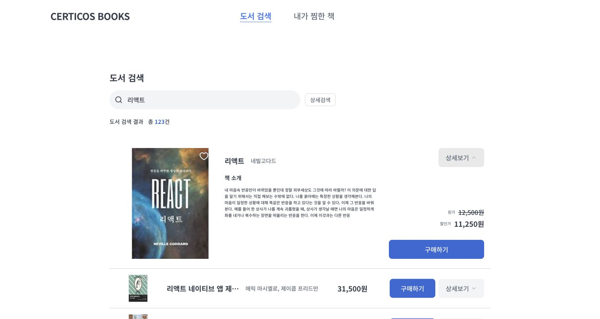
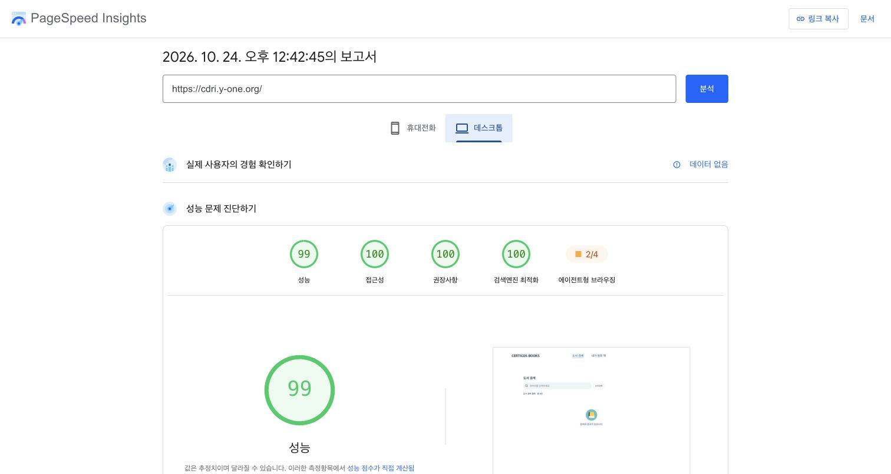
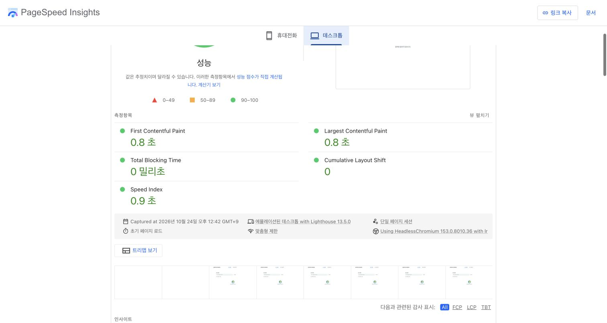
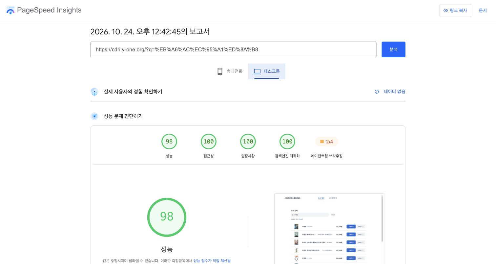
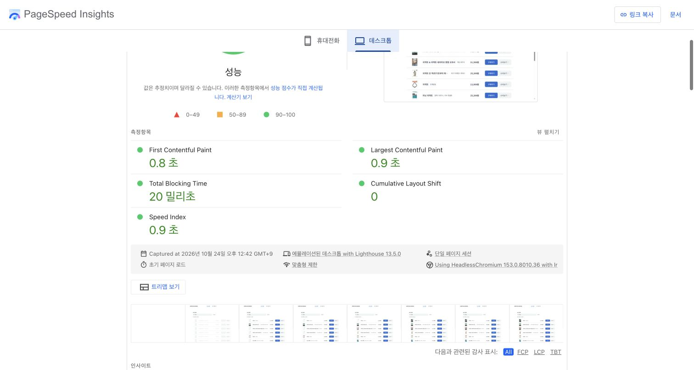
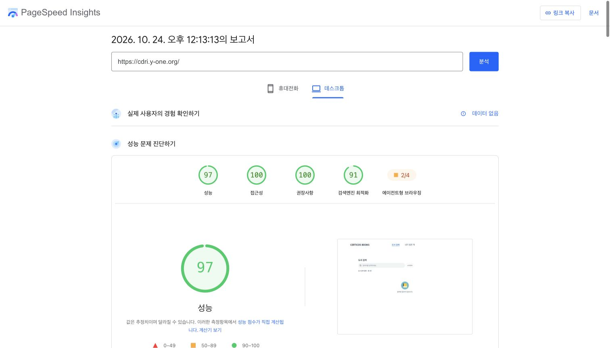
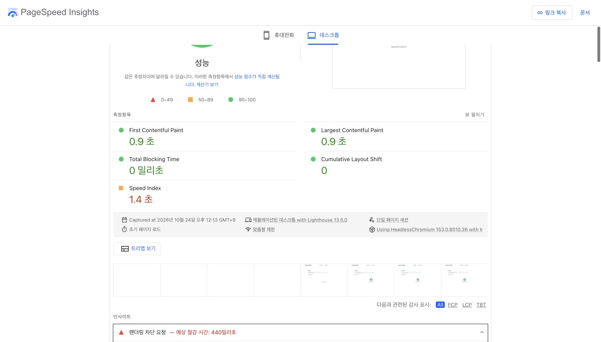
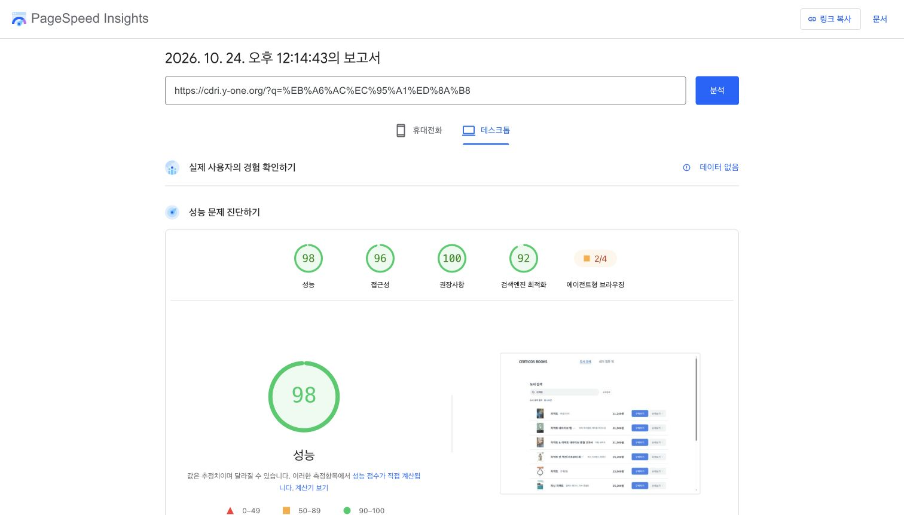
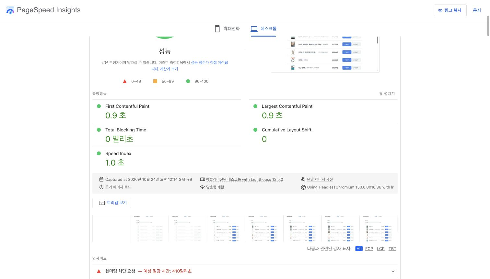

# PageSpeed 측정 기록

2026년 10월 24일 공개 배포의 개선 전 PageSpeed Insights 결과와, 후속 개선의 재배포·실제 동작 검증·재측정 결과를 기록한다.

개선 선택의 이유·대안·트레이드오프는 [ADR-0014](../adr/0014-pagespeed-guided-improvements.md)에 기록한다.

## 개선 전 측정 대상과 결과

| 항목                     | 초기 화면                                                                                                  | 리액트 검색 결과                                                                                           |
| ------------------------ | ---------------------------------------------------------------------------------------------------------- | ---------------------------------------------------------------------------------------------------------- |
| 대상 URL                 | [초기 화면](https://cdri.y-one.org/)                                                                       | [리액트 검색](https://cdri.y-one.org/?q=%EB%A6%AC%EC%95%A1%ED%8A%B8)                                       |
| 측정 시각 (한국 시간)    | 2026-10-24 12:13:13                                                                                        | 2026-10-24 12:14:43                                                                                        |
| 원본 보고서              | [초기 화면 보고서](https://pagespeed.web.dev/analysis/https-cdri-y-one-org/dsq0rgwelh?form_factor=desktop) | [검색 결과 보고서](https://pagespeed.web.dev/analysis/https-cdri-y-one-org/a4bsw1287w?form_factor=desktop) |
| 성능                     | 97                                                                                                         | 98                                                                                                         |
| 접근성                   | 100                                                                                                        | 96                                                                                                         |
| 권장사항                 | 100                                                                                                        | 100                                                                                                        |
| 검색엔진 최적화          | 91                                                                                                         | 92                                                                                                         |
| First Contentful Paint   | 0.9초                                                                                                      | 0.9초                                                                                                      |
| Largest Contentful Paint | 0.9초                                                                                                      | 0.9초                                                                                                      |
| Total Blocking Time      | 0ms                                                                                                        | 0ms                                                                                                        |
| Cumulative Layout Shift  | 0                                                                                                          | 0                                                                                                          |
| Speed Index              | 1.4초                                                                                                      | 1.0초                                                                                                      |

두 보고서는 Lighthouse 13.5.0·HeadlessChromium 153.0.8010.36의 에뮬레이션된 데스크톱에서 초기 페이지 로드를 측정했다. 네트워크 조건은 보고서에 표시된 맞춤형 제한을 사용했다.

### 해석 범위

- 두 URL은 서로 다른 화면을 측정한 결과다. 개선 전·후의 비교 점수로 사용하지 않는다.
- 실제 사용자 경험 데이터는 두 보고서 모두 없다. 위 수치는 단일 실행의 실험실 측정값이며 실제 사용자 전체의 Core Web Vitals 통과를 뜻하지 않는다.
- 제공된 개선 전 보고서는 데스크톱 결과다. 추가 페이지를 읽는 동안의 상호작용, 상세 펼침·찜·뒤로가기의 성능을 이 점수로 대신하지 않는다.
- 접근성 점수는 자동 감사의 결과다. 키보드·포커스 등 수동 검토가 필요한 범위는 [ADR-0012](../adr/0012-testing-and-deployment-validation.md)를 따른다.

## 확인한 문제와 후속 개선

아래 변경은 원본 보고서 확인 이후 반영하고 재배포했다. 원본 보고서의 점수와 캡처는 보존하며, 변경 후 결과는 아래에 별도로 기록한다.

### 1. Google Fonts 스타일시트 중복 선언 축소

두 보고서 모두 렌더링 차단 요청을 지적했다. 초기 화면 보고서에서 앱 CSS는 약 6KiB·50ms, Google Fonts CSS는 약 68.6KiB·340ms로 표시됐다. 미사용 CSS 절감 예상치도 대부분 Google Fonts에서 나왔다.

[index.html](../../index.html)의 개별 굵기 요청을 가변 굵기 범위 요청으로 변경했다. 같은 Chrome 사용자 에이전트로 Google Fonts 응답을 비교했을 때 실제 참조하는 폰트 파일 집합은 동일했다.

| 직접 비교한 값          | 변경 전       | 변경 후      |
| ----------------------- | ------------- | ------------ |
| CSS 원문                | 285,438 bytes | 95,642 bytes |
| CSS 로컬 gzip 압축      | 69,768 bytes  | 23,343 bytes |
| `@font-face` 선언       | 372개         | 124개        |
| 서로 다른 폰트 파일 URL | 124개         | 124개        |

CSS의 로컬 gzip 크기는 약 66.5% 줄었다. 이는 동일 요청 조건에서 응답 본문을 압축해 비교한 값이다. PageSpeed의 전송 크기나 변경 후 LCP 측정값과 동일시하지 않는다. 글꼴과 사용 굵기, `display=swap`, 사전 연결 설정은 유지한다. [Google Fonts 가변 굵기 범위 안내](https://developers.google.com/fonts/docs/css2#axis_ranges)

### 2. 빈 상태 아이콘의 내장 PNG 제거

기존 파일은 SVG 내부에 큰 PNG를 Base64로 포함하고 있었다. [빈 상태 아이콘](../../src/components/features/book/assets/empty-books.svg)의 원·책 표지·책장을 벡터 도형으로 다시 구성해, 원본 SVG 706,977 bytes를 811 bytes로 줄였다. 80×80 표시 공간은 유지하며, 기본 Vite 파비콘 경로도 이 아이콘을 사용하도록 수정했다.

이 크기 비교는 소스 파일 기준이다. 이번 프로덕션 빌드도 SVG를 0.81kB·gzip 0.43kB의 외부 자산으로 출력했다. 실제 전송량은 배포 후 압축·캐시 조건을 포함해 별도 확인해야 한다.

### 3. robots.txt의 SPA HTML 응답 수정

두 보고서 모두 `robots.txt`에서 HTML 문법을 읽고 25개 오류를 보고했다. 해당 파일이 없어 Cloudflare Pages의 SPA fallback이 앱 HTML을 반환한 것이 원인이다.

[public/robots.txt](../../public/robots.txt)를 추가해 일반 크롤링 규칙을 정적 텍스트로 제공한다. 앱의 경로 복원에 사용하는 SPA fallback은 유지한다. [Lighthouse robots.txt 감사 안내](https://developer.chrome.com/docs/lighthouse/seo/invalid-robots-txt/)

### 4. 검색 결과의 텍스트 대비 보완

검색 결과 보고서는 결과 건수의 파란색 텍스트, 구매 버튼의 흰색 글자, 상세보기 버튼의 글자 대비를 지적했다.

[Tailwind 토큰](../../tailwind.config.ts)에 일반 크기 텍스트와 흰색 버튼 글자를 위한 `primaryStrong`을 추가하고, 보조 텍스트를 조정했다. 결과·찜 건수와 공통 버튼, 검색 기록·가격 라벨·완료 안내에 적용했다. 원본 `primary`는 탐색 메뉴·포커스 표시 등에 유지한다.

| 색상 조합                       | 변경 전 대비율 | 변경 후 대비율 |
| ------------------------------- | -------------- | -------------- |
| 파란 배경과 흰색 버튼 글자      | 3.75:1         | 5.10:1         |
| 흰 배경과 결과 건수의 파란 글자 | 3.75:1         | 5.10:1         |
| 밝은 회색 배경과 보조 텍스트    | 4.22:1         | 4.89:1         |

값은 불투명한 기본 상태의 색상 토큰에서 계산했다. 기본 버튼의 hover 상태도 흰 배경 합성 기준 4.68:1이다. 일반 크기 텍스트의 4.5:1 기준을 충족하도록 조정했으며, 재배포 후 자동 접근성 감사 결과는 아래에 별도로 기록한다. [WCAG 텍스트 대비 기준](https://www.w3.org/WAI/WCAG22/Understanding/contrast-minimum.html)

## 남은 측정과 범위

- 검색 결과의 외부 표지는 API에서 받은 썸네일 URL을 사용한다. 보고서는 표시 크기보다 큰 이미지와 압축 효율을 지적했으며, 절감 예상치는 약 68KiB다. 제공되지 않은 작은 이미지 URL을 임의로 만들어 쓰거나 모든 표지를 더 낮은 해상도로 교체하지 않았다. 화면 배율과 펼친 표지 품질을 함께 고려해야 한다.
- 미사용 JavaScript 절감 예상치는 초기 화면 약 83KiB, 검색 결과 약 74KiB다. 개선 전 측정의 TBT는 두 화면 모두 0ms였다. 이 값만으로 추가 청크 분리의 효과를 단정하지 않으며, 상호작용과 실제 청크 사용량을 보고 후속 작업의 우선순위를 정한다.
- 제공된 두 보고서는 에이전트형 브라우징을 별도의 실험적 카테고리로 표시한다. 네 가지 주요 점수와 구분해 해석한다.
- 재배포 후에도 외부 폰트의 렌더링 차단과 미사용 CSS·JavaScript, 외부 표지의 전송 효율에 대한 권고가 남아 있다. 특히 아래 모바일 결과는 느린 4G에서 폰트 로딩을 더 살펴볼 필요가 있음을 보여준다.

### 후속 변경의 로컬 확인

앱·문서 프로덕션 빌드, 타입 검사, 린트, 포맷 검사를 통과했다. 빌드 결과 미리보기에서 실제 검색 결과와 변경한 버튼·건수 토큰, 가변 굵기 폰트 요청을 확인했다. `/robots.txt`는 HTTP 200·`text/plain`과 크롤링 규칙을 반환하며, `/favorites`의 SPA 진입과 성능 문서의 캡처 4장도 빌드 결과에 포함됐다. 이 확인은 Cloudflare 재배포와 개선 후 PageSpeed 측정을 대신하지 않는다.

## 재배포와 공개 환경 검증

- 대상: [공개 앱](https://cdri.y-one.org/)
- 배포 커밋: [8ff0652](https://github.com/Juyeong-Byeon/cdri-books-juyeong/commit/8ff0652)
- Cloudflare Pages 배포 완료: **2026-10-24 12:42:28 한국 시간**. 해당 커밋의 `Cloudflare Pages` 체크가 성공했다.
- [GitHub Actions](https://github.com/Juyeong-Byeon/cdri-books-juyeong/actions/runs/40059345336)도 같은 커밋에서 성공했다. 로컬 빌드·타입·린트·포맷 검사 및 push 훅의 테스트가 통과했다.
- 아래 동작은 재배포 후 공개 도메인의 Chrome에서 직접 조작하고, API·정적 자산은 공개 HTTPS 응답으로 확인했다. 응답 건수는 검증 시점의 값이다.

| 확인 항목             | 관찰한 결과                                                                                                                                                               |
| --------------------- | ------------------------------------------------------------------------------------------------------------------------------------------------------------------------- |
| 검색과 서버 프록시    | `리액트`를 Enter로 제출하면 URL에 검색어가 반영되고 총 123건 중 첫 10개가 표시됐다. 공개 `/api/books`의 첫 페이지도 JSON 문서 10개를 반환했다.                            |
| 추가 페이지           | 목록 하단으로 스크롤하면 로딩 표시 후 20개로 늘어났고 기존 첫 도서는 유지됐다. 두 번째 페이지 API도 첫 페이지와 다른 문서 10개를 반환했다.                                |
| 상세보기              | 표지가 확대되고 책 소개·원가·할인가·구매 링크가 표시됐다. 구매 링크의 새 탭 설정은 확인했으며 실제 구매는 수행하지 않았다.                                                |
| 상세검색·키보드       | 팝업의 저자명을 키보드로 선택하고 `무라카미 하루키`로 제출했다. 팝업이 닫히고 `target=person` URL과 총 780건의 결과를 확인했다. Esc 취소 시 트리거로 포커스가 돌아왔다.   |
| 방문 기록             | 뒤로가기로 `리액트`, 앞으로가기로 저자명 검색의 URL·입력·결과가 복원됐다.                                                                                                 |
| 찜·저장 복원          | 찜이 없는 상태에서 한 권을 추가해 찜 페이지의 1건 표시를 확인했다. 새로고침과 새 탭의 `/favorites` 직접 접속 후에도 유지됐다. 검증용 찜은 해제했다.                       |
| 직접 경로             | `/favorites` 직접 접속·새로고침과 검색 조건이 있는 URL의 새로고침 후 해당 화면이 표시됐다.                                                                                |
| 배포 자산             | 메인 HTML의 가변 굵기 폰트 요청과 새 SVG 참조를 확인했다. 배포 SVG 본문은 소스와 동일했다. `robots.txt`는 HTTP 200·`text/plain`과 크롤링 규칙을 반환했다.                 |
| 문서                  | 공개 성능 측정 문서와 ADR-0014가 앱 HTML 대신 해당 문서를 제공했다.                                                                                                       |
| 브라우저 오류·키 노출 | 검증 탭에서 수집된 콘솔 error는 없었다. 배포 JS에 알려진 로컬 API 키 문자열과 `KakaoAK` 인증 접두사가 포함되지 않았다. 서버 바인딩 전체에 대한 보안 감사를 뜻하지 않는다. |

브라우저 전체 종료·재실행 후 복원, 모바일 기기의 실제 조작, 스크린리더와 모든 키보드 경로는 이번 확인 범위에 포함하지 않았다. 새로고침·새 탭 복원 결과와 구분한다.

## 재배포 후 PageSpeed 결과

두 보고서 모두 **2026-10-24 12:42:45 한국 시간**에 생성했다. 위 배포 완료 이후의 측정이며, 개선 전과 같은 URL·Lighthouse·HeadlessChromium 버전·에뮬레이션된 데스크톱·맞춤형 제한으로 비교한다.

| 항목                     | 초기 화면                                                                                           | 리액트 검색 결과                                                                                    |
| ------------------------ | --------------------------------------------------------------------------------------------------- | --------------------------------------------------------------------------------------------------- |
| 새 보고서                | [초기 화면](https://pagespeed.web.dev/analysis/https-cdri-y-one-org/uqbcdkj5ml?form_factor=desktop) | [검색 결과](https://pagespeed.web.dev/analysis/https-cdri-y-one-org/i734ej895c?form_factor=desktop) |
| 성능                     | 99                                                                                                  | 98                                                                                                  |
| 접근성                   | 100                                                                                                 | 100                                                                                                 |
| 권장사항                 | 100                                                                                                 | 100                                                                                                 |
| 검색엔진 최적화          | 100                                                                                                 | 100                                                                                                 |
| First Contentful Paint   | 0.8초                                                                                               | 0.8초                                                                                               |
| Largest Contentful Paint | 0.8초                                                                                               | 0.9초                                                                                               |
| Total Blocking Time      | 0ms                                                                                                 | 20ms                                                                                                |
| Cumulative Layout Shift  | 0                                                                                                   | 0                                                                                                   |
| Speed Index              | 0.9초                                                                                               | 0.9초                                                                                               |

초기 화면은 성능 점수가 올랐고, 검색 결과는 성능 점수를 유지하면서 접근성과 SEO가 개선됐다. 두 화면의 `robots.txt` 오류와 검색 결과의 대비 지적은 새 감사에서 해소됐다. 검색 결과의 TBT는 개선 전보다 증가했으므로 모든 지표가 좋아졌다고 해석하지 않는다.

같은 설정의 단일 실행끼리 비교한 결과이며, 네트워크·측정 시점의 변동을 통제한 반복 실험은 아니다. 실제 사용자 데이터는 새 보고서에도 없고, 실사용 Core Web Vitals 통과나 각 변경의 독립적인 인과 효과를 증명하지 않는다. [PageSpeed의 실험실·실사용 데이터 안내](https://developers.google.com/speed/docs/insights/v5/about)

### 함께 생성된 모바일 결과

같은 보고서의 모바일 탭도 확인했다. 에뮬레이션된 Moto G Power·느린 4G 조건이며, 개선 전 모바일 기준값이 없어 전후 비교로 사용하지 않는다.

| 항목                | [초기 화면 모바일](https://pagespeed.web.dev/analysis/https-cdri-y-one-org/uqbcdkj5ml?form_factor=mobile) | [검색 결과 모바일](https://pagespeed.web.dev/analysis/https-cdri-y-one-org/i734ej895c?form_factor=mobile) |
| ------------------- | --------------------------------------------------------------------------------------------------------- | --------------------------------------------------------------------------------------------------------- |
| 성능                | 84                                                                                                        | 85                                                                                                        |
| 접근성·권장사항·SEO | 각각 100                                                                                                  | 각각 100                                                                                                  |
| FCP                 | 3.3초                                                                                                     | 3.3초                                                                                                     |
| LCP                 | 3.5초                                                                                                     | 3.4초                                                                                                     |
| TBT                 | 0ms                                                                                                       | 20ms                                                                                                      |
| CLS                 | 0                                                                                                         | 0                                                                                                         |
| Speed Index         | 3.3초                                                                                                     | 3.3초                                                                                                     |

모바일에서는 렌더링 차단의 예상 절감 시간이 두 화면 모두 약 1.7초로 남아 있다. 데스크톱 점수가 높다는 이유로 모바일 로딩도 충분하다고 판단하지 않는다.

## 개선 후 초기 화면 캡처

## 개선 후 검색 결과 캡처

## 개선 전 초기 화면 캡처

[원본 초기 화면 보고서](https://pagespeed.web.dev/analysis/https-cdri-y-one-org/dsq0rgwelh?form_factor=desktop)

## 개선 전 검색 결과 캡처

[원본 검색 결과 보고서](https://pagespeed.web.dev/analysis/https-cdri-y-one-org/a4bsw1287w?form_factor=desktop)

